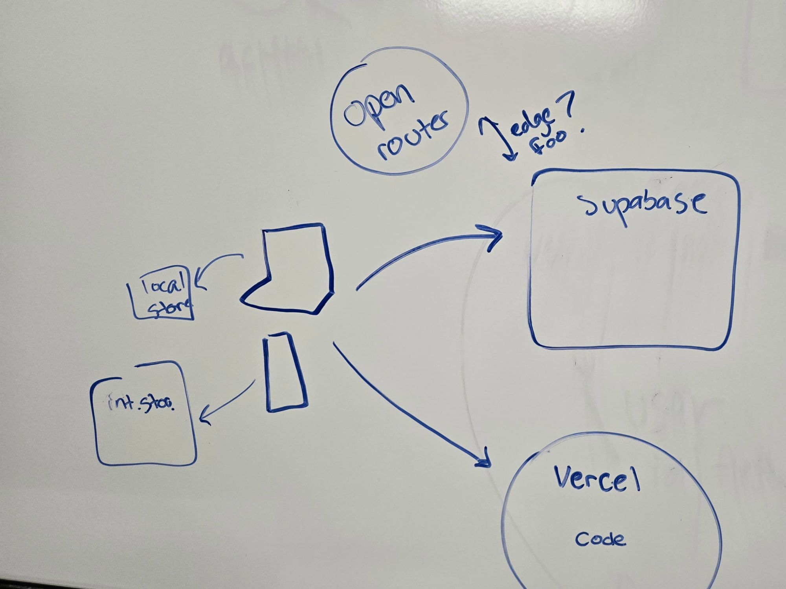
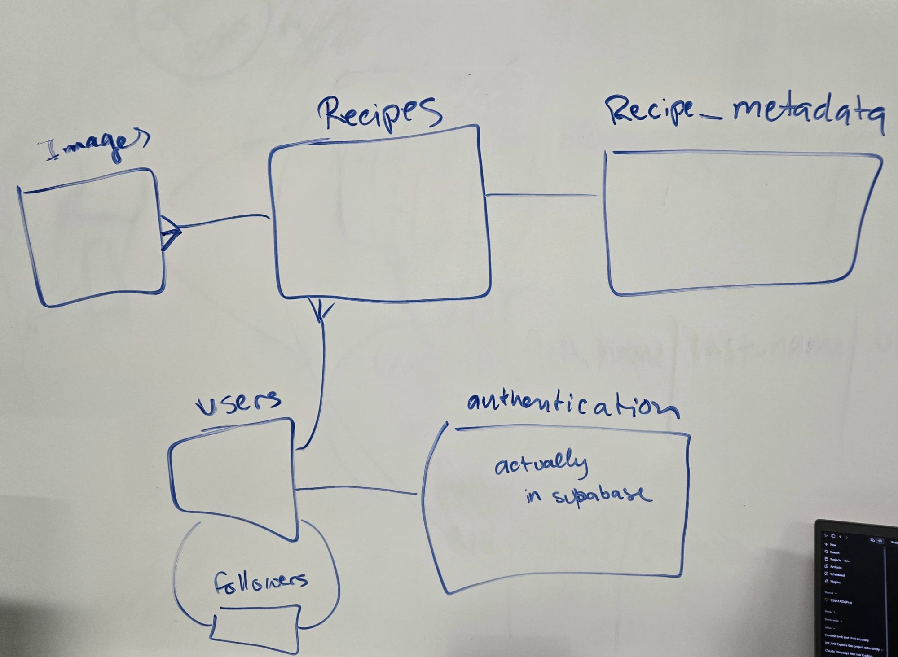

# Project Initial Design

I am on the quest for a perfect recipe management system. I want the format to look like the obsidian vault I have on my phone and for recipes to be tag-able and filterable. People should have private and public recipes and be able to share their recipes or copy public ones. It will need to be able to store pictures, text, and user-specific recipe metadata. I want AI integration so that you can have an agent quickly transcribe a recipe from a picture or website into your.

The service should be fast and smooth whether you are online or offline and work well on phone or laptop. I would prefer to make an android app, but I've never coded for a phone before so I will probably start with a website and then make a PWA webapp for android. 

I plan to use supabase and vercel. This will be a great way to connect with people and help people make better food to make more connections.

## Initial System Design

## Initial ERD

## Daily goals

I want to work on this roject in 1-3 hour segments at least twice a week at first. First I will get the website and database working, I will iron out my data model in the process, then I will work on making PWA for Android and then add AU integration.